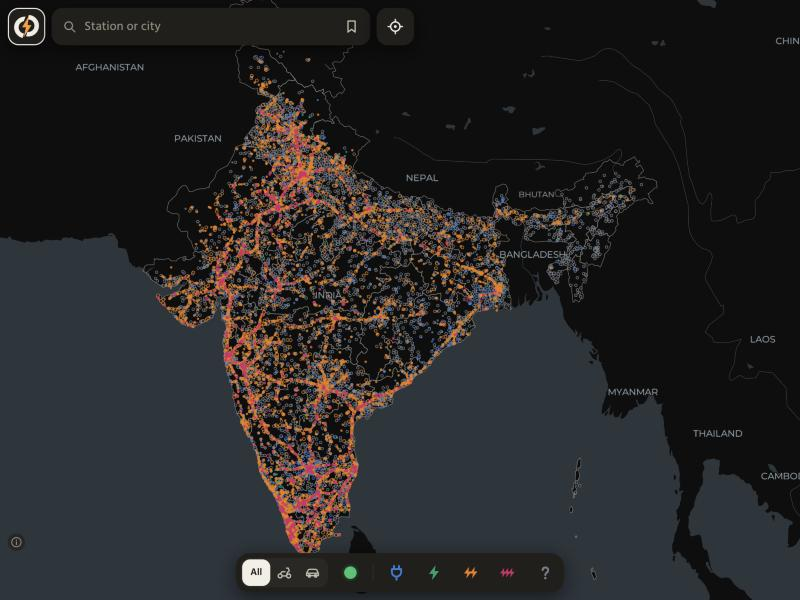
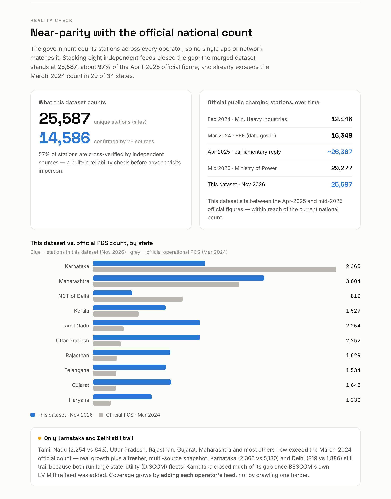
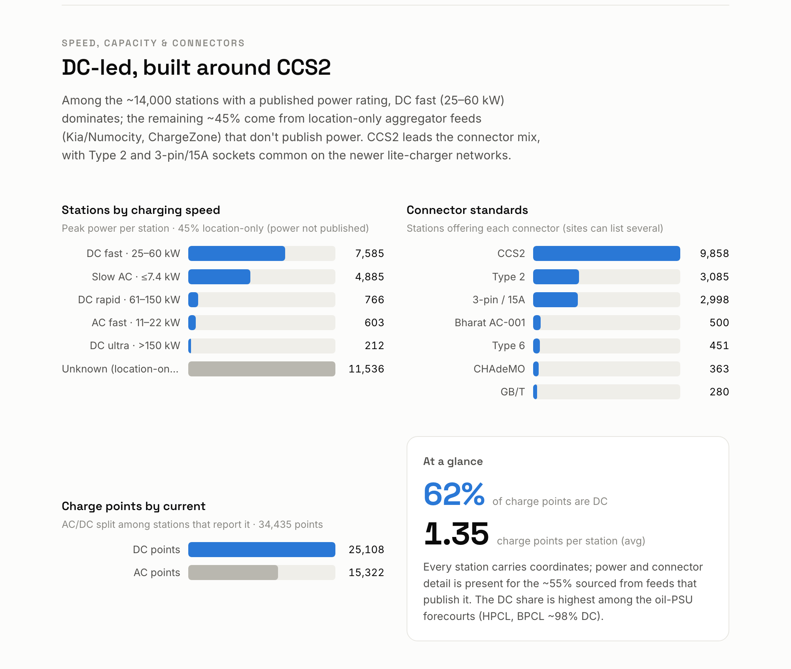
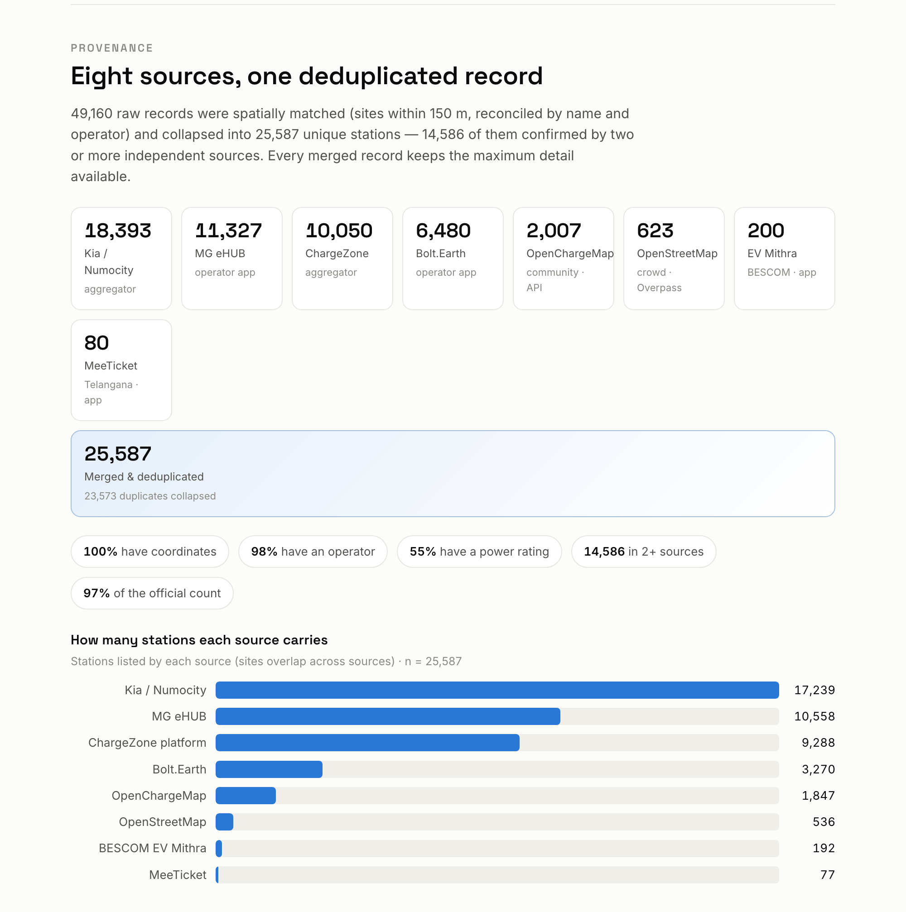

# India EV Charging Stations - a single merged dataset

A deduplicated, geo-located dataset of **25,587 public EV charging stations across India**, compiled from eight independent sources and reconciled into one record per site. Every station carries coordinates; 14,586 are confirmed by two or more sources.

**Live map: [ev.reclaim.city](https://ev.reclaim.city)**

Compiled 15 November 2026 - 25,587 stations - 34 states and union territories - 223 operators - 8 sources.

---

## What is in here

| File | Rows | Description |
|------|------|-------------|
| [`data/charging_stations.csv`](data/charging_stations.csv) | 25,587 | The full dataset, one row per station. |
| [`data/charging_stations.json`](data/charging_stations.json) | 25,587 | The same records as JSON, with structured connector arrays. |
| [`dashboard.html`](dashboard.html) | - | A self-contained analytics dashboard (open in any browser). |

The dashboard is also published as pictures and tables below.

### Column reference (CSV)

| Column | Meaning |
|--------|---------|
| `name` | Station name as published by the source. |
| `operator` | Charge-point operator / network brand. |
| `network` | Platform or back-end the station runs on, where known. |
| `state`, `district`, `city` | Administrative location (state/district assigned by point-in-polygon against India admin boundaries). |
| `address`, `postcode` | Street address where published. |
| `lat`, `lng` | WGS84 coordinates. Present for 100% of rows. |
| `connectors` | Connector types with power/count, e.g. `CCS2@60kW; Type2@7kW`. |
| `max_power_kw` | Peak power at the station, where published. |
| `ac_points`, `dc_points`, `n_points` | Charge-point (gun) counts by current, where published. |
| `access` | Access codes (public / restricted) as provided by the source. |
| `pricing` | Tariff string where published, e.g. `Rs 14/kWh`. |
| `phone`, `url` | Contact details where published. |
| `sources` | Which sources list this station (after dedup), e.g. `MG eHUB; Kia/Numocity`. |
| `n_sources` | Number of independent sources that list it. |
| `last_updated` | Most recent source timestamp for the record. |

Power, connector and tariff detail is present for roughly 55% of stations - the two large aggregator feeds are location-only and do not publish it. Those figures describe only the ~14,000 stations that report it.

---

## Sources

Eight independent sources were merged. Each is attributed; see [SOURCES.md](SOURCES.md).

| Source | Type | Stations listed |
|--------|------|-----------------|
| Kia / Numocity | Aggregator platform | 17,239 |
| MG eHUB | Operator app network | 10,558 |
| ChargeZone | Aggregator platform | 9,288 |
| Bolt.Earth | Operator app network | 3,270 |
| OpenChargeMap | Community, open API | 1,847 |
| OpenStreetMap | Crowd-sourced, Overpass | 536 |
| BESCOM EV Mithra | State-utility app (Karnataka) | 192 |
| MeeTicket | State vendor (Telangana) | 77 |

Sites overlap across sources, so the listed counts sum to more than the merged total. 49,160 raw records collapsed to 25,587 unique stations - 23,573 duplicates removed by spatial deduplication.

---

## The dataset at a glance

### How it compares to the official national count

Government counts of operational Public Charging Stations (PCS): 16,348 at March 2024 (BEE), about 26,367 by April 2025, and 29,277 by mid-2025 (Ministry of Power). This dataset finds **25,587** - about 97% of the April-2025 figure, and above the March-2024 count in 29 of 34 states.

### Where the stations are

Maharashtra leads, followed by Karnataka, Tamil Nadu and Uttar Pradesh. The top eight states hold roughly 60% of all chargers.

| State / UT | Stations | Per million people | Official PCS (Mar 2024) |
|------------|---------:|-------------------:|------------------------:|
| Maharashtra | 3,604 | 28.3 | 3,083 |
| Karnataka | 2,365 | 34.7 | 5,130 |
| Tamil Nadu | 2,254 | 29.2 | 643 |
| Uttar Pradesh | 2,252 | 9.5 | 583 |
| Gujarat | 1,648 | 22.8 | 476 |
| Rajasthan | 1,629 | 19.9 | 500 |
| Telangana | 1,534 | 40.1 | 483 |
| Kerala | 1,527 | 42.5 | 958 |
| Haryana | 1,230 | 40.2 | 377 |
| Madhya Pradesh | 1,167 | 13.3 | 341 |
| Andhra Pradesh | 1,088 | 20.4 | 327 |
| NCT of Delhi | 819 | 37.6 | 1,886 |
| West Bengal | 767 | 7.7 | 318 |
| Punjab | 736 | 24.0 | 158 |
| Odisha | 603 | 12.9 | 198 |

The full 34-row table (every state and UT, with per-capita density) is in the dashboard:

### Operators

223 distinct operators appear. The leaders split into oil PSUs (near-100% DC, flat Rs 14/kWh), conglomerates (Tata, Jio-bp, Adani) and pure-play CPOs (ChargeZone, Statiq, Bolt). ChargeZone's station count is an upper bound - its B2C app aggregates roaming partners.

| Operator | Type | Stations | Guns | DC share | Median kW | Rs/kWh | States |
|----------|------|---------:|-----:|---------:|----------:|-------:|-------:|
| ChargeZone | Pure-play CPO | 8,020 | 2,160 | 39% | 60 | 22 | 34 |
| Statiq | Pure-play CPO | 2,405 | 1,031 | 92% | 60 | 23 | 30 |
| Tata Power | Conglomerate | 2,388 | 4,735 | 63% | 25 | 21 | 30 |
| HPCL eCharge | PSU oil | 2,197 | 4,101 | 98% | 30 | 14 | 27 |
| Bolt.Earth | Pure-play CPO | 2,069 | 2,439 | 80% | 3.3 | - | 23 |
| eDrive BPCL | PSU oil | 1,231 | 2,001 | 99% | 30 | 14 | 25 |
| Jio-bp Pulse | Conglomerate | 1,128 | 4,844 | 51% | 60 | 24 | 27 |
| Adani Total Energies | Conglomerate | 864 | 985 | 71% | 30 | 26 | 26 |
| EFi | Pure-play CPO | 570 | 20 | 34% | 3.3 | - | 30 |
| Zeon Charging | Pure-play CPO | 474 | 984 | 76% | 42 | 22 | 13 |

### Speed, capacity and connectors

Among stations that publish power, DC fast (25-60 kW) dominates, built around the CCS2 connector. Of 34,435 charge points whose current type is published, 62% are DC.

### Tariffs

Across 10,429 priced stations the median is Rs 21/kWh. The distribution is bimodal: a wall at exactly Rs 14 (the subsidised oil-PSU tariff) and a private-CPO market at Rs 21-26.

### Provenance

---

## Method

- **Merge.** 49,160 raw records collapsed to 25,587 by spatial deduplication: sites within 150 m treated as one when closer than 75 m or when name/operator agree; every non-null field and connector kept from the richest source.
- **Cleaning.** Junk power values nulled (ceiling 400 kW), test and commissioning units removed, and a small number of out-of-land coordinates relocated or dropped against India admin boundaries.
- **Geocoding of admin units.** State and district assigned by point-in-polygon against India administrative boundaries.
- **Cross-verification.** 14,586 stations (57%) appear in two or more independent sources.

### Caveats

- Power, connector and tariff detail is missing for about 45% of stations (the two aggregator feeds are location-only).
- ChargeZone's total includes B2C roaming aggregation and is an upper bound.
- `status` and tariff fields are point-in-time snapshots from each source.
- Counts are stations (sites), not individual guns, unless a column says otherwise.
- Per-capita figures use IIPS district population projections (2024) and exclude states under 1 million people.

---

## License and attribution

Data is released under the **Open Database License (ODbL) 1.0** (see [LICENSE](LICENSE)). You may share and adapt it, with attribution, and must keep derivative databases open under the same terms.

Attribution: *EV Charge India dataset - ev.reclaim.city*, incorporating data from MG eHUB, BESCOM EV Mithra, ChargeZone, Kia/Numocity, Bolt.Earth, OpenChargeMap (openchargemap.org), OpenStreetMap (OpenStreetMap contributors, ODbL) and MeeTicket. Official counts from data.gov.in / BEE / Ministry of Power. Population from IIPS projections.

### How to cite

> EV Charge India (2026). *India EV Charging Stations - a merged dataset of 25,587 public charging stations.* ev.reclaim.city.

Maintained by Reclaim Chennai. Issues and corrections welcome.
